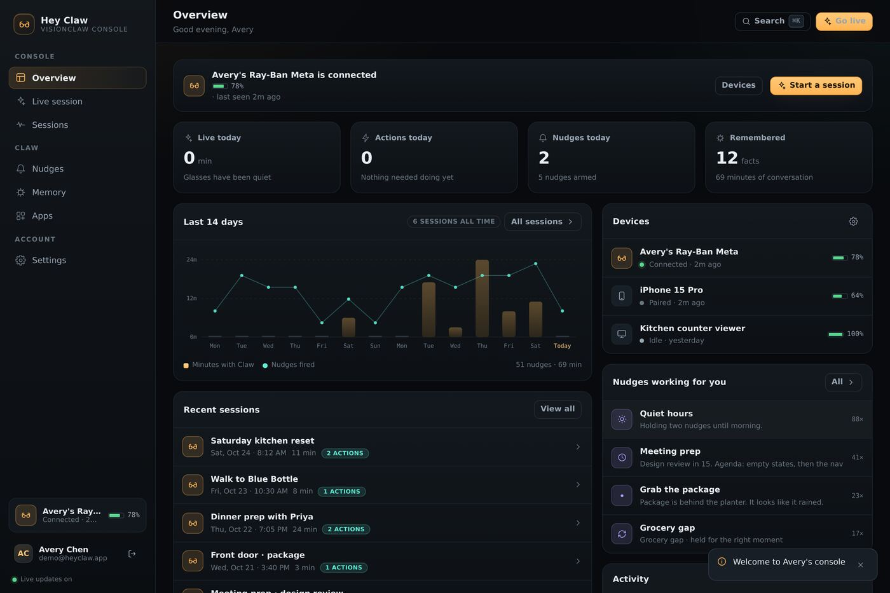
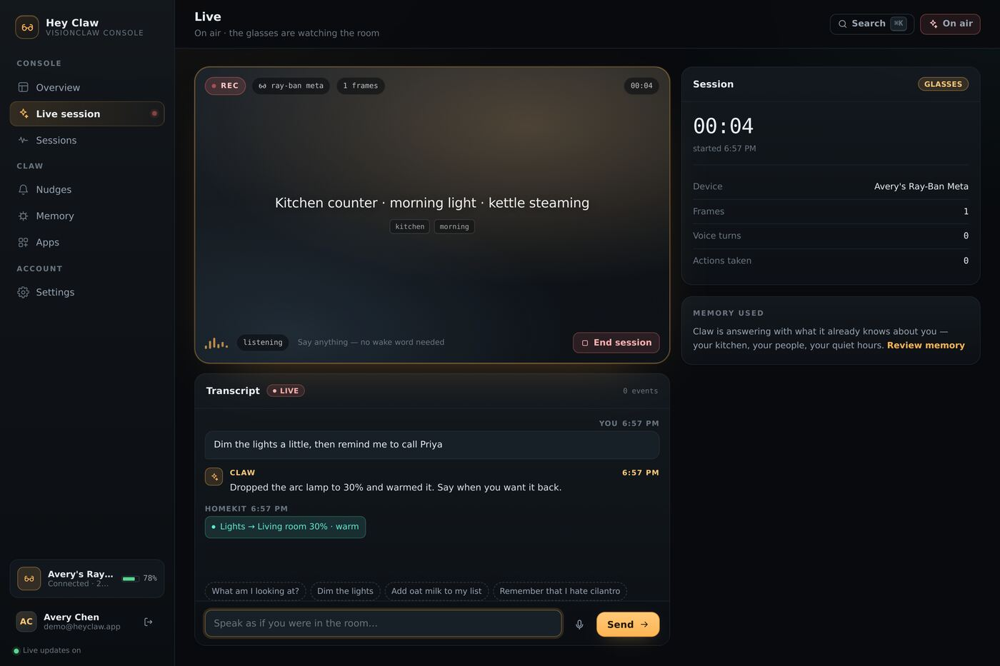
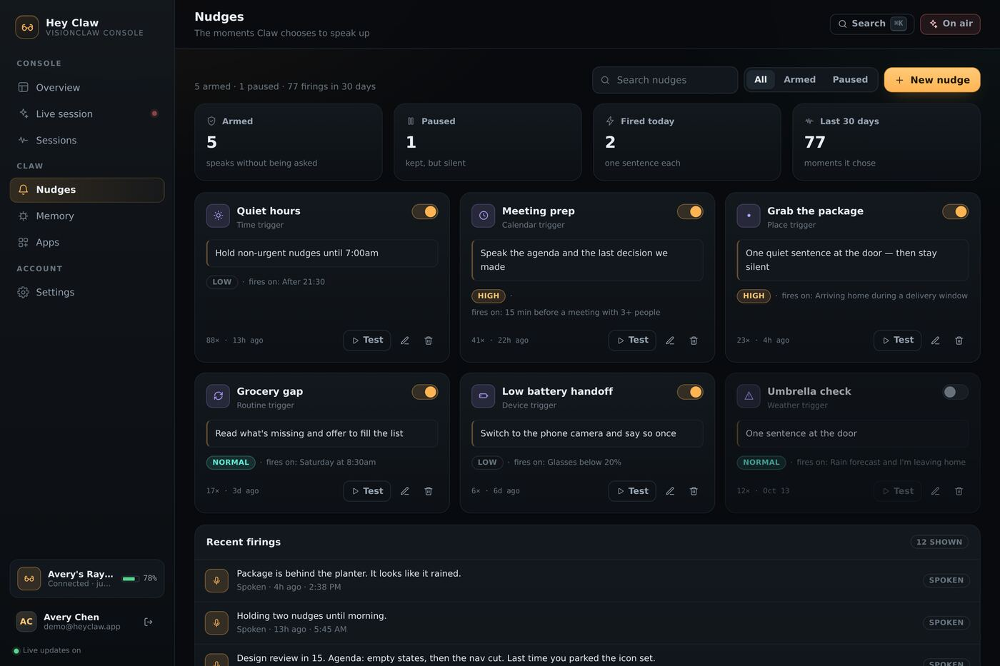
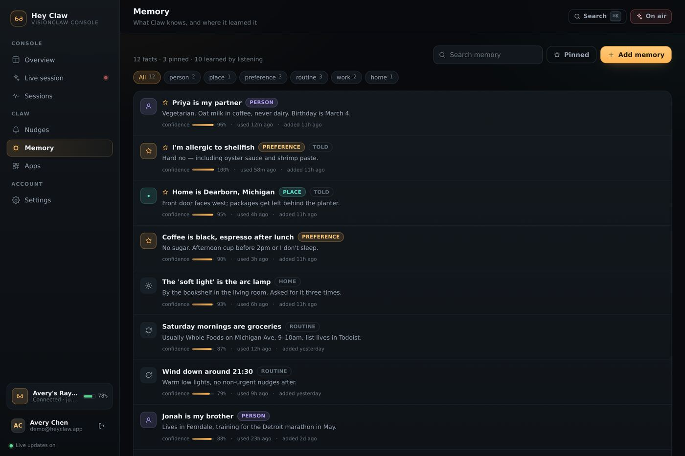

# Hey Claw — the VisionClaw web console

**Live AI through Meta glasses, with no prompt required.**

Hey Claw is the web console for people who wear [VisionClaw](../README.md). The
glasses are the interface; this is the quiet place you go afterwards (or before)
to see what Claw did on its own, tune the rules that let it speak first, and
start a session from a browser.



```
your glasses ── frames + voice ──▶ VisionClaw ──▶ Hey Claw ──▶ this console
                                 (gateway + agent)   (SQLite/SSE)
```

The console is a complete application: token auth, a dashboard shell with
sidebar navigation, CRUD for every resource, optimistic updates, server-sent
live updates, empty/loading states, and a seeded demo account so it feels alive
on first load.

| | |
|---|---|
| **Live session** | [](docs/05-live-on.jpg) |
| **Nudges** | [](docs/06-nudges.jpg) |
| **Memory** | [](docs/08-memory.jpg) |

---

## Run it

```bash
cd heyclaw
npm start          # http://localhost:3000
```

No install step: the app is **Node 22 + the standard library only** — no runtime
dependencies, no bundler, no build. `node:sqlite` (built into Node 22) is the
database.

Sign in with the seeded demo account, or press **Enter the demo account**:

```
demo@heyclaw.app / glasses123
```

| Script | What it does |
|---|---|
| `npm start` | Serve the app on `PORT` (default 3000) |
| `npm run dev` | Same, restarting on `src/` and `public/` changes |
| `npm run seed` | Seed the demo account if missing |
| `npm run reset` | Delete + reseed the demo account |
| `npm test` | 33 API tests (auth, isolation, validation, CRUD) |
| `npm run smoke` | Headless client pass (needs `npm i -D jsdom`) |

Environment knobs: `PORT`, `HOST`, `HEYCLAW_DB` (SQLite path, default
`heyclaw/data/heyclaw.db`), `HEYCLAW_SEED=0` (no demo data), `HEYCLAW_LOG=0`
(quiet request log).

---

## What's in it

### The product idea

VisionClaw's whole claim is that you talk to your glasses instead of your phone.
The console is built around the three things that make that feel alive:

1. **Live** — a session viewfinder that shows what the glasses see, a
   transcript of the turn-by-turn, and the actions Claw took (lights, orders,
   lists, notes) without you opening an app.
2. **Nudges** — the rules that let Claw *speak first*: at the door when a
   package is out in the rain, 15 minutes before a meeting with a parked
   decision, after quiet hours. "No prompt" is a feature you configure, not a
   magic trick.
3. **Memory** — what Claw knows ("the soft light is the arc lamp"), where it
   learned it, how sure it is, and how to forget it.

### Screens

| Route | What you can do |
|---|---|
| `/overview` | Today's minutes/actions/nudges, a 14-day chart, recent sessions, devices, the nudges doing the most work, activity feed |
| `/live` | Start (glasses or phone camera), talk, watch frames arrive, test-voice input, end and review the session |
| `/sessions` | Search/filter the archive, open any transcript in a drawer, rename, delete |
| `/nudges` | Create/edit/delete, arm/pause with a switch, "test" one to see exactly what gets spoken, firing history |
| `/memory` | Search/filter by category, pin, edit confidence, forget, add by hand |
| `/apps` | Connect / pause / disconnect accounts and see the scopes granted |
| `/settings` | Profile, wake word + voice (with a browser voice preview), language, autonomy, retention, devices (rename, ping, unpair, pair), password, export, delete history |

Plus a ⌘K command palette that searches memory, nudges, and sessions and can
jump anywhere; toasts; keyboard-dismissable modals with focus traps; and
responsive layouts down to 390px (drawer navigation, 2×2 stat blocks).

### Full-stack behaviours

- **Auth** — scrypt password hashes, opaque random bearer tokens (stored hashed),
  30-day sliding sessions, httpOnly cookie *and* `Authorization: Bearer` so it
  works without local storage, per-email attempt throttling, 401 → back to sign-in.
- **Persistence** — SQLite with WAL, foreign keys, and cascading deletes. Every
  list you see is a real query; nothing is mocked in the client.
- **Isolation** — every query is scoped by user, and the tests assert that one
  account can't read or mutate another's rows.
- **Optimistic UI** — pins, nudge toggles, deletes, app connects, and sent voice
  turns render immediately and roll back (with a toast) if the server disagrees.
- **Live updates** — `GET /api/events` is an SSE stream; the server pushes
  session starts, frames, actions, nudge firings, memory changes, and device
  state. Two tabs stay in sync, and the engine keeps writing while you're on
  another screen (the sidebar shows an on-air dot).
- **Loading / empty / error states** — skeletons for every list, deliberate
  first-run copy for a brand-new account, and error states with retry.
- **Validation** — shared field-level 422s (`{ error, details }`) rendered next
  to the offending input, on both client and server.

### The live simulation

There is no camera in a browser, so `src/live.js` simulates the VisionClaw loop:
it writes the same event shapes the gateway records (`scene` / `claw` / `user` /
`action`) into SQLite ~1 second apart and pushes them over SSE. Saying
*"remember that I hate cilantro"* really does write a memory row (watch it appear
on `/memory`); *"dim the lights"* produces a HomeKit action; ending the session
computes the duration and summary and files it in `/sessions`.

Swap `live.js` for the gateway's `/v1/chat/completions` turn endpoint and the rest
of the console keeps working unchanged — that boundary is the point.

---

## Layout

```
heyclaw/
├── src/
│   ├── server.js      # http server: API router, SSE, static files, CSP
│   ├── api.js         # every endpoint (auth, overview, live, CRUD, search, export)
│   ├── auth.js        # scrypt hashes, bearer tokens, throttling
│   ├── db.js          # node:sqlite schema + tiny query helpers
│   ├── live.js        # session engine (frames, replies, actions)
│   ├── seed.js        # demo account + first-run content
│   ├── content.js     # shared vocabulary (triggers, categories, voices)
│   ├── catalog.js     # connectable-app catalog with scopes
│   ├── hub.js         # SSE fan-out
│   ├── http.js        # router, JSON helpers, static serving, errors
│   └── validate.js    # field validators
├── public/
│   ├── index.html     # shell (client renders everything)
│   ├── styles.css     # design tokens + layout + components
│   └── js/
│       ├── app.js     # boot, auth screens, shell, router, palette, SSE
│       ├── api.js     # fetch client, token store, EventSource wrapper
│       ├── ui.js      # DOM helpers, formatting, toasts, modals, states
│       ├── icons.js   # inline icon set
│       └── views/     # overview, live, sessions, nudges, memory, apps, settings
├── test/api.test.js   # node:test suite
└── tools/             # smoke.mjs (jsdom walk-through), shots.mjs (screenshots)
```

### API surface

```
POST   /api/auth/signup | login | demo | logout      GET /api/auth/me
GET    /api/overview                                 GET /api/search?q=
GET    /api/live/state    POST /api/live/start | say | stop
GET    /api/sessions      GET|PATCH|DELETE /api/sessions/:id
GET    /api/devices       POST /api/devices          PATCH|DELETE /api/devices/:id
GET    /api/memories      POST /api/memories         PATCH|DELETE /api/memories/:id
GET    /api/nudges        POST /api/nudges           PATCH|DELETE /api/nudges/:id
POST   /api/nudges/:id/fire                          GET /api/nudges/:id
GET    /api/connections   POST /api/connections/:slug/connect|disconnect
PATCH  /api/connections/:slug
PATCH  /api/settings      POST /api/settings/password | clear-sessions
GET    /api/export        GET /api/events (SSE)
```

### Seed data

The demo account (Avery Chen, Dearborn MI) has 46 days of history: 6 sessions with
full transcripts (kitchen reset, coffee walk, dinner prep, porch package, meeting
prep, bike ride), 12 memories, 6 nudges with firing history, 6 connected apps for
9 in the catalog, 3 devices, and a 30-day activity shape. It's written through
the same inserts the API uses, so nothing is special-cased.

> Note on the simulation: the demo `created_at` dates and the live event stream
> are generated, but the *schema*, the *queries*, and the *UI* are the real thing.
> Connecting this to a production gateway means replacing `src/live.js` (events)
> and the `/connect` handlers (OAuth) — not the console.

---

## Tests

```bash
npm test        # 33 API assertions against a throwaway database
npm run smoke   # renders the real client in jsdom and walks every view
```

The smoke run boots the server, loads `public/js/app.js` in jsdom with a stubbed
`EventSource`, signs in with the demo account, visits all seven routes, starts a
live session, sends a voice turn, creates a nudge and a memory, connects an app,
opens a session drawer, runs a search, and checks the sign-out path — failing on
any uncaught exception or console error.

`tools/shots.mjs` renders desktop and mobile screenshots in Chromium (needs
`npm i puppeteer-core` plus a Chromium build); it's how the images at the top of
this file were produced.
